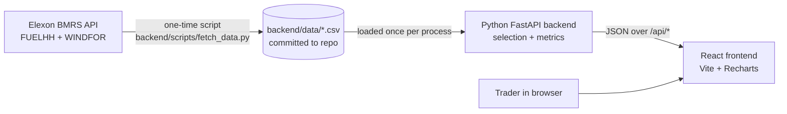
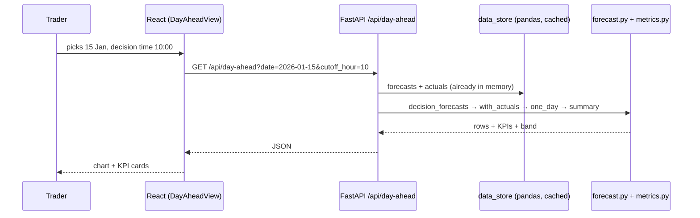

# Architecture — GB Wind Forecast Monitor

A small web app for a UK utility's **day-ahead trading team**. It answers two questions:

1. **"What did the latest wind forecast say for tomorrow, at the moment I had to decide?"**
2. **"How much can we trust that forecast?"** (measured error against what really happened)

Scope: national GB **wind** only, Elexon data only, purchase decisions made in **January 2026**
(so delivery days **2 Jan → 1 Feb 2026**).

---

## 1. Domain in plain words

| Term | Meaning |
|---|---|
| Day-ahead market | Power for day **D** is bought on day **D-1**, before the auction closes (mid-morning UK time). |
| Decision time (cutoff) | When the trader must decide. Default **D-1 10:00 UK time**; the user can change it (00:00–23:00). |
| Actual (FUELHH, `fuelType=WIND`) | Metered wind generation in MW, every **30 min** (`startTime`). |
| Forecast (WINDFOR) | Predicted wind generation in MW, **hourly** `startTime`. **8 runs per day** (`publishTime` 02:30, 04:30, 07:30, 09:30, 11:30, 15:30, 18:30, 22:30 UTC), each looking **46–66 h** ahead. |
| Horizon / lead time | `startTime − publishTime`: how far ahead the forecast was made. |
| Error | **actual − forecast**. Negative = less wind than forecast = the trader has to buy more at short notice. |

### The core rule (most important logic in the app)

> For each target hour T on delivery day D, use the forecast with the **latest `publishTime` that is ≤ the cutoff (D-1 at the chosen hour, UK time)**.

This is the forecast the trader *really had* when deciding. Using any later forecast would be
look-ahead bias, and that is tested explicitly.

Things we learned from the real data (and handle):
- With the 10:00 cutoff the **09:30 run on D-1** is used. It covers D at 14.5–37.5 h ahead.
- The 22:30 run only reaches 46.5 h ahead. So for a cutoff **before 02:30**, hours 22:00–23:00 of D have
  **no forecast available**. The app does not invent values; it shows a note instead.
- Forecasts are hourly and actuals are half-hourly, so we **compare on the hour** (actual at `HH:00`).

---

## 2. System overview



**Why pre-download the data?** January 2026 is in the past, so the data will not change. Saving it as CSV
makes the app fast, means the demo cannot break if Elexon is slow, and makes tests repeatable.
Re-run the script at any time to refresh it.

Snapshot contents: 19,272 forecast rows (264 runs, 30 Dec 2025 → 31 Jan 2026) and
1,536 actual rows (every half hour of 1 Jan → 1 Feb 2026, no gaps).

---

## 3. Folder structure

```
<repo>/
├── README.md                   # what / how to run / live link
├── ARCHITECTURE.md             # this file
├── IMPLEMENTATION_PLAN.md      # the phase-by-phase build plan
├── docker-compose.yml          # runs backend + frontend locally
├── vercel.json                 # Vercel Services: backend at /api/*, frontend at /
│
├── backend/
│   ├── Dockerfile
│   ├── .python-version         # 3.12 (used by Vercel)
│   ├── requirements.txt        # runtime packages
│   ├── requirements-dev.txt    # + pytest, httpx
│   ├── app/
│   │   ├── config.py           # constants: delivery dates, default cutoff, paths
│   │   ├── data_store.py       # load CSVs into pandas once (lru_cache)
│   │   ├── forecast.py         # CORE: pick latest forecast before the cutoff
│   │   ├── metrics.py          # MAE, RMSE, bias, percentiles, by-hour, by-horizon, bias correction
│   │   └── main.py             # FastAPI routes (thin)
│   ├── data/
│   │   ├── actuals_wind.csv    # startTime, generation
│   │   └── forecasts_wind.csv  # publishTime, startTime, generation
│   ├── scripts/
│   │   └── fetch_data.py       # downloads from Elexon → CSV
│   └── tests/
│       ├── test_forecast.py    # selection rule, time zones, real-data checks
│       ├── test_metrics.py     # metrics vs hand-calculated values
│       └── test_api.py         # endpoints, validation errors
│
└── frontend/
    ├── Dockerfile              # build with Node, serve with nginx
    ├── nginx.conf              # serves the app, forwards /api → backend container
    ├── vite.config.js          # dev server, proxies /api → localhost:8000
    ├── index.html
    └── src/
        ├── main.jsx            # React entry
        ├── App.jsx             # header, decision-time selector, tabs
        ├── api.js              # fetch helpers + useApi hook (loading / error state)
        ├── theme.js            # chart colours (light/dark) + number formatting
        ├── styles.css          # all styling, light + dark via CSS variables
        └── components/
            ├── DayAheadView.jsx   # Tab 1: forecast vs actual for one delivery day
            ├── AccuracyView.jsx   # Tab 2: error analysis for the whole month
            ├── KpiCard.jsx        # small number tile
            └── ChartCard.jsx      # titled chart box + Status (loading / error)
```

---

## 4. Backend (Python / FastAPI)

### 4.1 `data_store.py`: loading
Reads both CSVs with pandas, parses times as UTC, keeps only on-the-hour actuals.
`lru_cache` makes it load once per process (also fine on serverless).

### 4.2 `forecast.py`: the core rule
| Function | What it does |
|---|---|
| `delivery_day(start_times)` | UK calendar day each target hour belongs to. |
| `decision_cutoff(days, cutoff_hour)` | D-1 at `cutoff_hour` UK local time, converted to UTC (handles GMT/BST). |
| `decision_forecasts(forecasts, cutoff_hour)` | For every target hour in 2 Jan → 1 Feb: drop runs published after its cutoff, keep the latest remaining one. Returns `startTime, publishTime, forecast, horizon_h, day`. |
| `with_actuals(selected, actuals)` | Joins on `startTime`, adds `error = actual − forecast`. |
| `one_day(selected, day)` | Filters to one delivery day. |

It is fully vectorised in pandas (no Python loops over rows): filter → sort by `publishTime` → `groupby(startTime).last()`.

### 4.3 `metrics.py`: error statistics
- **MAE**: typical miss in MW (headline). **nMAE %** = MAE ÷ mean actual.
- **RMSE**: punishes big misses. **Bias**: mean error (is the forecast systematically high or low?).
- **P10 / P50 / P90 of error**: "80% of hours the actual was between forecast + P10 and forecast + P90".
  Used for the shaded band in the day view and as a safety margin for buying.
- **By hour of day**, **by day**, **histogram** (500 MW bins).
- **By horizon**: MAE grouped by lead time (0–6 h … 42–48 h), using *all* runs. This shows that forecasts
  made further ahead are worse.
- **Bias correction (walk-forward)**: each day's forecast is shifted by the mean error of *earlier days
  only*. This shows how much a simple correction would help without cheating.

### 4.4 `main.py`: API endpoints
| Method & path | Params | Returns |
|---|---|---|
| `GET /api/health` | – | `{"status":"ok"}` |
| `GET /api/meta` | – | delivery date range, default cutoff |
| `GET /api/day-ahead` | `date=2026-01-15`, `cutoff_hour=10` | hourly points (forecast, actual, error, horizon, P10–P90 band), forecast run used, day KPIs |
| `GET /api/accuracy` | `cutoff_hour=10` | month KPIs, histogram, by-hour, daily, by-horizon, bias correction |

Validation: a malformed date or `cutoff_hour` outside 0–23 gives **422** (FastAPI automatic); a date outside
the delivery range gives **400**. The results per cutoff hour are cached (`lru_cache`).
Interactive docs: `/docs` (Swagger).

---

## 5. Frontend (React + Vite + Recharts)

- **Header**: title + **decision time** selector (shared by both tabs).
- **Tab 1, Day-ahead forecast**: date picker with ←/→, a banner *"Showing the forecast published 14 Jan
  09:30, the latest one available at your decision time of 14 Jan 10:00"*, 4 KPI cards, and a chart of
  forecast (blue) vs actual (orange) with a shaded P10–P90 band.
- **Tab 2, Forecast accuracy**: 4 KPI cards (MAE, bias, P10/P90, worst hour), a **"What this means for
  buying"** box written in plain words, and 4 charts (by day, by lead time, by hour, error histogram).

Data flow: control changes → `useApi` hook calls `api.js` → state → charts re-render. There is no global state
library. The tab is kept in the URL hash (`/#accuracy`), so views can be linked. Colours come from a
colour-blind-validated palette, with separate light and dark mode values.

---

## 6. Request flow end-to-end



---

## 7. Run & deploy

| Where | How |
|---|---|
| Docker | `docker compose up --build` → app http://localhost:8080, API docs http://localhost:8000/docs |
| Local dev | `cd backend && uvicorn app.main:app --reload` and `cd frontend && npm run dev` → http://localhost:5173 |
| Production | **Vercel Services** (one project, one domain): `backend` service = FastAPI from `backend/` (entrypoint `app.main:app`), public at `/api/*`. `frontend` service = Vite build of `frontend/`, public at `/`. The browser calls `/api` on the same domain, so no CORS and no service bindings are needed. |

---

## 8. Key engineering practices

- **No look-ahead bias**, tested on synthetic cases *and* on the full real dataset for all 24 cutoff hours.
- **Pure functions** for selection and metrics (DataFrame in → DataFrame/dict out), so they are easy to unit test.
- **Thin API layer**: routes only validate and call logic.
- **Data snapshot committed** → reproducible builds, demos and tests. The fetch script can be re-run.
- **Config in one place** (`config.py`).
- **Docker** (multi-stage frontend build, nginx) + **Vercel** for zero-ops hosting.
- Small, phase-by-phase commits. **AI-assisted development** declared in the README.

## 9. Findings from the January 2026 data (10:00 cutoff)

| Metric | Value |
|---|---|
| MAE | ~2.0 GW (17.7% of mean wind output) |
| Bias | −1.7 GW: forecast systematically **too high** |
| P10 / P90 error | −4.2 GW / +0.5 GW |
| MAE by lead time | rises from 1.7 GW (0–6 h) to 2.3 GW (42–48 h) |
| Walk-forward bias correction | MAE 1,991 → 1,464 MW (**−26%**) |

A likely reason for the bias: WINDFOR estimates what the wind farms could produce, while FUELHH is metered
output *after* curtailment (wind turned down for grid constraints). This is a hypothesis to confirm with more data.

## 10. Known limitations / next steps
- Wind only; solar and demand forecasts would give a full residual-demand view.
- Hourly comparison only (the half-hour actuals at :30 are not used).
- The P10–P90 band uses the whole month's errors (fine for a pilot review; live use should use only past data).
- Next: live data refresh, a bias-corrected forecast as a product feature, per-market auction times, alerts when
  forecast runs change a lot.
