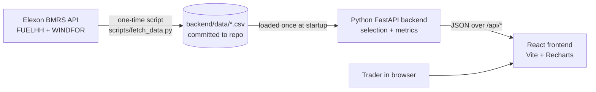
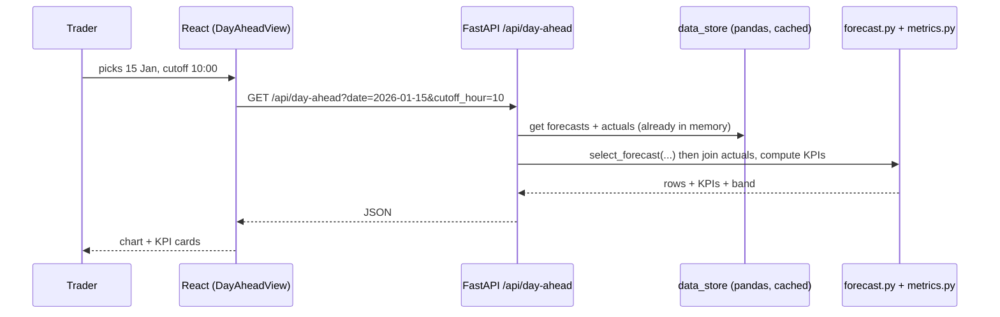

# Architecture — UK Wind Forecast Monitor

A small web app for a UK utility's **day-ahead trading team**. It answers two questions:

1. **"What does the latest wind forecast say for tomorrow?"** (the forecast they could actually see at decision time)
2. **"How much can we trust that forecast?"** (measured error, compared with what really happened)

Scope: national GB **wind** only, Elexon data only, purchase decisions made in **January 2026**.

---

## 1. Domain in plain words

| Term | Meaning |
|---|---|
| Day-ahead market | Power for day **D** is bought on day **D-1**, before the auction closes (about 09:20–11:00 UK time). |
| Decision time (cutoff) | When the trader must decide. Default **D-1 10:00 UK time** (the user can change this). |
| Actual (FUELHH, `fuelType=WIND`) | Metered wind generation in MW, every **30 min** (`startTime`). |
| Forecast (WINDFOR) | Predicted wind generation in MW, **hourly** `startTime`. A new forecast run is published about every 2–3 h (`publishTime`) and looks ~2–3 days ahead. |
| Horizon / lead time | `startTime - publishTime`, meaning how far ahead the forecast was made. |
| Residual demand | Demand minus wind, meaning what must be bought from other sources. Wind error therefore turns straight into buying error. |

**The core rule (the most important logic in the app):**

> For each target hour T on delivery day D, use the forecast from the **latest `publishTime` that is ≤ the cutoff (D-1 10:00)**.

This is the forecast the trader *really had* when they decided. Using any later forecast would be cheating ("look-ahead bias").

Sample data checked on the live API:
- WINDFOR: `{"publishTime":"2026-01-10T11:30:00Z","startTime":"2026-01-09T21:00:00Z","generation":12443}`
- FUELHH: `{"startTime":"2026-01-10T23:30:00Z","fuelType":"WIND","generation":8051, ...}`

Because forecasts are hourly and actuals are half-hourly, **we compare only on the hour** (we use the actual at `HH:00`). This is simple and easy to explain. (Another option would be to average the two half-hours. We note it but do not build it.)

---

## 2. System overview



**Why pre-download the data?** January 2026 is in the past, so the data will not change. Saving it as CSV:
- makes the app fast (no Elexon call per request),
- means the deployed demo cannot break if Elexon is slow or down,
- makes tests repeatable.

The fetch script can be re-run at any time to refresh it.

---

## 3. Folder structure

```
<repo>/
├── README.md                  # what/how/link (required deliverable)
├── ARCHITECTURE.md            # this file
├── IMPLEMENTATION_PLAN.md     # step-by-step build plan
├── docker-compose.yml         # runs backend + frontend locally
├── vercel.json                # Vercel deploy config (static frontend + Python API)
│
├── api/
│   └── index.py               # Vercel entrypoint: `from app.main import app`
│
├── backend/
│   ├── Dockerfile
│   ├── requirements.txt       # fastapi, uvicorn, pandas, requests, pytest
│   ├── app/
│   │   ├── main.py            # FastAPI app, routes, CORS
│   │   ├── config.py          # constants: dates, default cutoff, data paths
│   │   ├── data_store.py      # load CSVs into pandas once (cached)
│   │   ├── forecast.py        # CORE: pick latest forecast before cutoff
│   │   └── metrics.py         # MAE, RMSE, bias, percentiles, by-hour, by-horizon
│   ├── data/
│   │   ├── actuals_wind.csv   # startTime, generation
│   │   └── forecasts_wind.csv # publishTime, startTime, generation
│   ├── scripts/
│   │   └── fetch_data.py      # downloads from Elexon → CSV
│   └── tests/
│       ├── test_forecast.py   # selection rule (no look-ahead!)
│       └── test_metrics.py
│
└── frontend/
    ├── Dockerfile
    ├── package.json
    ├── vite.config.js         # dev proxy /api → backend:8000
    └── src/
        ├── main.jsx
        ├── App.jsx            # header + two tabs
        ├── api.js             # fetch helpers for /api/*
        ├── components/
        │   ├── DayAheadView.jsx    # Tab 1: forecast for a chosen delivery day
        │   ├── AccuracyView.jsx    # Tab 2: error analysis for all of Jan 2026
        │   ├── KpiCard.jsx         # small number tiles
        │   └── Controls.jsx        # date picker + cutoff hour selector
        └── styles.css
```

---

## 4. Backend (Python / FastAPI)

### 4.1 Data loading — `data_store.py`
- Reads both CSVs with pandas, parses times as UTC.
- Actuals are filtered to on-the-hour rows (`minute == 0`) for comparison.
- Wrapped in `functools.lru_cache`, so data loads once per process (also fine for serverless).

### 4.2 Core logic — `forecast.py`

```python
def select_forecast(forecasts, delivery_day, cutoff_hour) -> DataFrame:
    cutoff = (delivery_day - 1 day) at cutoff_hour, Europe/London → UTC
    runs   = forecasts[forecasts.publishTime <= cutoff]
    latest = runs.publishTime.max()
    return runs[(runs.publishTime == latest) & (startTime within delivery_day)]
```

Then it joins with actuals on `startTime` and returns rows like:
`{time, forecast, actual, error, publishTime, horizon_h}`.

Notes:
- "Delivery day" = UK calendar day (Europe/London). January is GMT, so UK time = UTC, which keeps things simple. We still use the timezone properly.
- If a forecast row is missing for some hour, that hour is skipped (never filled with made-up data).

### 4.3 Metrics — `metrics.py`
For all delivery days 1–31 Jan 2026, using the same cutoff rule:
- **MAE** (mean absolute error, MW): the main "typical miss" number.
- **RMSE** (MW): punishes big misses.
- **Bias / mean error** (MW): does the forecast tend to be too high or too low?
- **P10 / P50 / P90 of error**: "in 80% of hours the real wind was between forecast −X and +Y MW". **This is the number traders can use directly** as a safety margin.
- **Normalised MAE (%)**: MAE ÷ mean actual, so it is easy to compare.
- **Error by hour of day** (0–23): which hours are harder to forecast.
- **Error by horizon** (bonus): MAE grouped by lead time (e.g. 12–24h, 24–36h, 36–48h), using *all* forecast runs. This shows that "older forecasts are worse".

Error convention: **error = actual − forecast** (positive = more wind than forecast = you over-bought).

### 4.4 API endpoints — `main.py`

| Method & path | Params | Returns |
|---|---|---|
| `GET /api/health` | – | `{"status":"ok"}` |
| `GET /api/meta` | – | available date range, default cutoff |
| `GET /api/day-ahead` | `date=2026-01-15`, `cutoff_hour=10` | hourly series (forecast, actual, error), forecast publishTime used, day KPIs, P10/P90 band |
| `GET /api/accuracy` | `cutoff_hour=10` | overall KPIs, error histogram bins, by-hour MAE, by-horizon MAE, daily MAE list |

Bad input (date outside January, hour not 0–23) returns **HTTP 400** with a clear message.

---

## 5. Frontend (React + Vite + Recharts)

Two tabs, one simple header ("GB Wind Forecast Monitor — Jan 2026").

**Tab 1 — Day-Ahead View** (question 1)
- Controls: delivery date picker (Jan 2026), decision cutoff hour (default 10:00).
- Text label: *"Using forecast published 2026-01-14 09:30 UK (latest before your 10:00 cutoff)"*.
- Line chart: forecast (blue) vs actual (green), with a shaded **P10–P90 uncertainty band** around the forecast (taken from historical errors).
- KPI cards: forecast total MWh for the day, actual MWh, MAE for the day, max miss.

**Tab 2 — Forecast Accuracy** (question 2)
- KPI cards: MAE, RMSE, bias, normalised MAE %, P10/P90.
- Histogram of errors.
- Bar chart: MAE by hour of day.
- Bar chart: MAE by forecast horizon.
- Line chart: daily MAE across January (spot bad days, e.g. storms).
- A short "What this means for buying" box, e.g. *"Plan for wind to come in up to X MW below forecast in 1 hour out of 10."*

Data flow inside the frontend: `Controls` change state → `useEffect` calls `api.js` → result stored in `useState` → charts re-render. No Redux, no extra state library.

---

## 6. Request flow end-to-end



---

## 7. Run & deploy

| Where | How |
|---|---|
| Local (Docker) | `docker compose up --build` → frontend http://localhost:5173, API http://localhost:8000/docs |
| Local (no Docker) | `uvicorn app.main:app --reload` in `backend/`, `npm run dev` in `frontend/` |
| Production | **Vercel**: `frontend/` is built as a static site. `api/index.py` runs FastAPI as a Python serverless function on the same domain (`/api/*`), so CORS is not needed in production. |

Why Vercel and not Heroku: Vercel is free, hosts React and a Python API in one project, and deploys from GitHub on every push.

---

## 8. Key engineering practices (talking points for the tech lead)

- **No look-ahead bias**: tested explicitly. A forecast published after the cutoff must never be chosen.
- **Pure functions** for selection and metrics (DataFrame in, DataFrame/dict out). They are easy to unit test without HTTP.
- **Thin API layer**: routes only validate input and call logic.
- **Data snapshot committed**, so builds and demos are reproducible. The fetch script is idempotent.
- **Config in one place** (`config.py`): dates, default cutoff, paths.
- **Docker** for the same environment everywhere. **Vercel** for zero-ops hosting.
- **AI-assisted development** is declared in the README.

## 9. Known limitations / next steps
- Wind only. Solar and demand forecasts would give a full residual-demand view.
- Hourly comparison only (half-hour actuals at :30 are not used).
- Cutoff is one hour for all days. Real auction times could be modelled per market (N2EX / EPEX).
- Next steps: live data refresh, probabilistic forecast, alerts when forecast runs change a lot.
